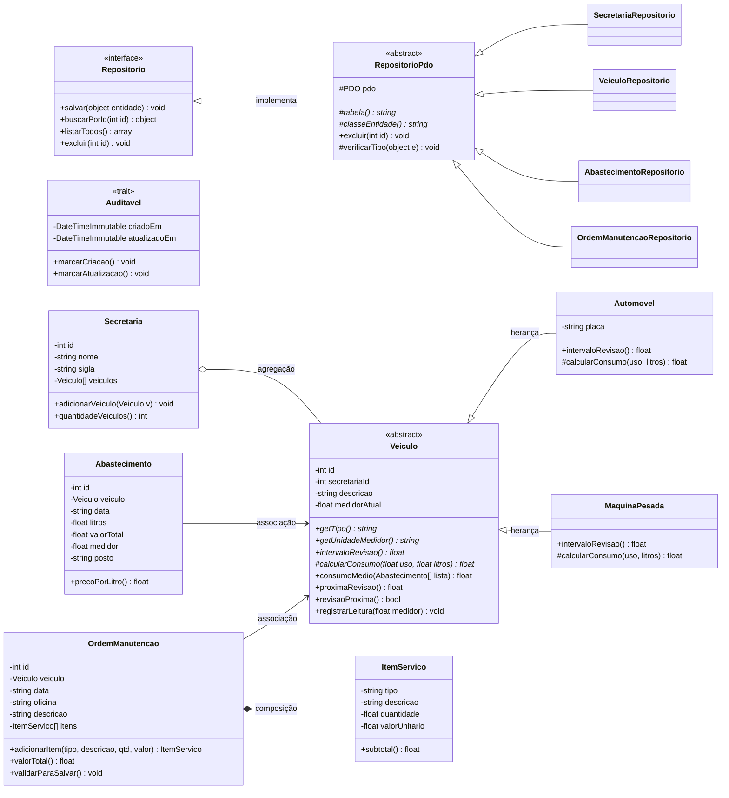
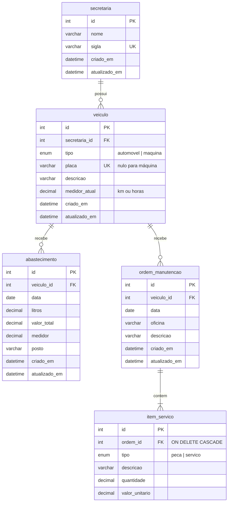

# Diagramas do FrotaGov

> O GitHub desenha estes diagramas automaticamente (Mermaid).
> Para colocar no artigo/slides: abra https://mermaid.live, cole o código e exporte como PNG.

## Diagrama de classes (UML)

Classes que usam o trait `Auditavel`: Secretaria, Veiculo, Abastecimento, OrdemManutencao.

## Modelo do banco de dados (ER)

